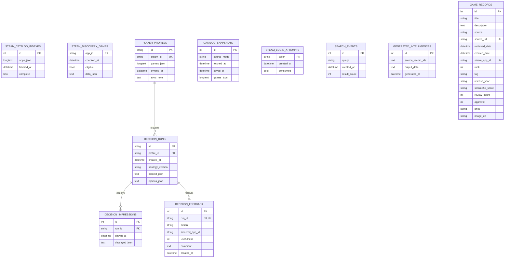

# GameScope ERD

The original library and A4/A5 history remain independent. A6 adds profiles,
immutable decision runs, display impressions, and one editable feedback row per
run. `catalog_snapshots` stores the latest validated chart without claiming an
unknown-date bundled snapshot is live. No existing table columns were changed.

